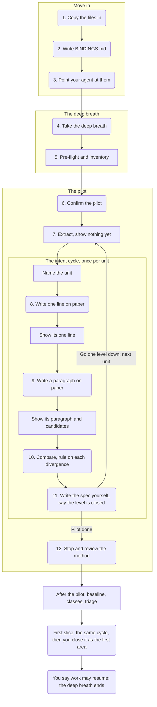

# Becoming a citizen of Kowloon

A short guide for a person bringing a repository into Kowloon. It explains and points; it carries no rules. Where it differs from `ALIGNMENT.md` or the files under `method/`, they are right.

## What Kowloon is

Kowloon is a method for working with coding agents in a repository that already exists, finding out or confirming what the code is for, with a human signing the statements of intent and preventing agents from changing those on their own.

It works backward first, from code to intent, and only then forward.

## Citizenship requirements

- **Ownership.** A **maintainer**: one person who decides what the project's intent is, willing to leave their signature. Usually the owner.
- **Calm.** A pause in feature work while the first area is aligned. The deep breath.
- **Clear boundaries.** Agents never write intent, and nothing is deleted until a person names it.

You also need:

- A git repository.
- A **tutor**: a person who can answer what a piece of work is for. It may be the maintainer at first.
- A coding agent.
- Later, not on day one: an SSH signing key that no agent can read or use. `BINDINGS.md` says how you keep it so.

## The files

| File | Who reads it | When |
| --- | --- | --- |
| `HOWTO.md` | You | Once, now |
| `ALIGNMENT.md` | The agent, and you | Every session |
| `BINDINGS.md` | The agent, and you. You write it | Every session |
| `method/intent.md` | The agent, and you | When classifying files or writing intent |
| `method/process.md` | The agent, and you | At each alignment step |
| `method/changes.md` | The agent | When you ask for a change to code |
| `method/gate.md` | You | When the first area is about to close |

Read `ALIGNMENT.md` in full before starting. It is about 1,300 words. Skim the rest.

## First steps

The numbers in the drawing are the steps below. Rounded boxes are yours; square boxes are the agent's.

1. **Copy the files in.** Put `ALIGNMENT.md` and `method/` at the repository root. You never edit them.
2. **Write `BINDINGS.md`.** Copy `BINDINGS.template.md` to `BINDINGS.md` at the root and fill it in. It binds the method's terms to your project: who the maintainer and tutor are, where your packages and documents are, what your interfaces are, and which capability you will start with. Write "Not decided" where you do not know yet; the template says which step that will stop.
3. **Point your agent at them.** Add one line yourself to the instruction file your agent already reads (`AGENTS.md`, `CLAUDE.md` or the like): "Read `ALIGNMENT.md` and `BINDINGS.md` before anything else." The agent may not make this edit for you.
4. **Take the deep breath.** This is the calm requirement: the deep breath is the pause in feature and fix work while the first area is aligned. In every agent session, on every machine, say:

   > Stop all current work and start the alignment process in `ALIGNMENT.md`.

   The agent lists what was unfinished in `alignment/in-flight.md`. Nothing is deleted or finished.
5. **Let the agent run pre-flight and the inventory.** Both are read-only. You get a report of what instruction files, memory and documents exist, and whether your setup can sign and can start a blind session.
6. **Confirm the pilot.** It is the one you named in `BINDINGS.md`: one small capability (a command, an endpoint or a port-level function), the most mechanical you have.
7. **Have the agent extract.** In a fresh session, it works out what the code actually does. It shows you nothing yet.
8. **Write one line on paper.** The agent names the unit under alignment, here the pilot capability, and asks you to write one line of intent for it. Write it on paper, which keeps it out of the repository, out of the chat, and out of anything the agent can read. Tell the agent when it is written, not what it says. Only then does the agent show the one line it thinks the intent is.
9. **Write a paragraph on paper.** The same again at paragraph length: what that capability must do and must never do. When you say it is written, the agent shows its own paragraph, and then its candidates, with file and line for each.
10. **Compare.** Put your paper beside the agent's line, paragraph and candidates. Each difference becomes a divergence. You decide, one by one, whether the code is wrong or your statement was.
11. **Write the spec yourself.** With the differences ruled on, write the unit's intent under `spec/` in your own words. The agent never words it for you. Then tell the agent the level is closed: that is how a unit is done.

    Steps 7 to 11 are the intent cycle, and they run once per unit. To refine further, go one level down: the agent names the next unit, a module the capability reaches, and the cycle starts again with a new line and a new paragraph on paper. Stop when the pilot has told you enough, or when its time box ends.
12. **Stop and review the method.** Note what was missing, what was never used, and what got in the way. Strike the unused parts before going further.

Only after the pilot: the baseline, proposed classes, triage, and the first slice. Only when that first area is ready to close: signing and the gate. Once it is closed, you may end the deep breath. The pilot alone does not end it.

The same cycle is used later for every change of intent: the agent names the unit, you write a line and then a paragraph on paper, and you write the spec.

## Your roadmap and unfinished branches

- **Plans stay as they are, with no force.** A plan item counts only when you restate it yourself as a spec item. Assume an agent wrote every plan unless you know you did. `method/process.md` has the rule.
- **Paused branches wait for their capability.** When you reach it, you either name the branch for removal or bring the work back as a new requested change or an experiment. The old branch is only a reference.
- **Afterwards the roadmap is short:** it consists of the signed items nothing serves yet, plus the proposed changes still open.

## Who does what

Ownership is the left column. Clear boundaries keep the agent in the right one.

| You | The agent |
| --- | --- |
| Write and sign intent under `spec/` | Extracts candidates and drafts proposals |
| Rule on each divergence | Records divergences, leaves the ruling blank |
| Close an area and name what is removed | Reports and waits |
| Create the signing key and the gate | Runs the gate and reads its result |

## What you can ignore at first

Zones, budgets, signed assumptions, experiments, the order of traversal, the reading check, the release report and the gate. The pilot needs none of them.

## Mistakes to avoid

- **Typing your intent where the agent can read it, or reading the agent's version before writing yours.** The comparison only works if the two were written apart. That is what the paper is for.
- **Letting the agent write under `spec/`.** It shows what it thinks; you write. That is the first clear boundary.
- **Cleaning up early.** Nothing is deleted until its area is closed and you have named the removal. That is the second. Removal should be intentional too.
- **Treating a candidate as confirmed.** A candidate is what the code does, not what you want. If something is not intentional it should be addressed, either by adapting or removing it.
- **Building the gate first.** Write it when there is something signed to protect.
- **Adding rules before a pilot asked for them.** A new rule enters as a method lesson, after something happened that needed it.

## If you get stuck

Ask the agent to stop and report. Section 13 of `ALIGNMENT.md` lists when it must do so on its own.

If the trouble is in the intent itself, go back to `spec/` and read what is there: is it consistent, and is it minimal?
